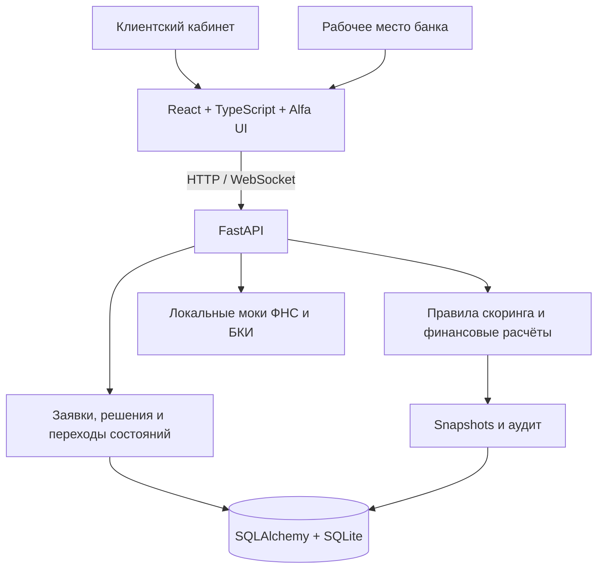
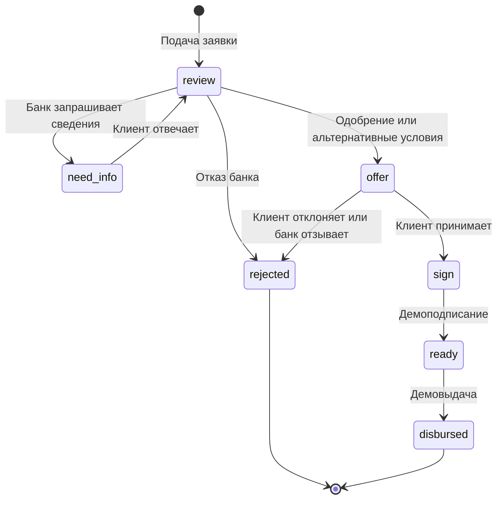

# Альфа / Поток

**Умный кредитный кабинет предпринимателя и рабочее место сотрудника банка.**

Прототип связывает подбор финансирования, подачу заявки, проверки, решение банка и получение результата в один процесс. Данные и история сохраняются на сервере; клиент и банк видят изменения через WebSocket с резервным опросом API.

> Это демонстрационный MVP по кейсу «Умный кредитный кабинет предпринимателя». Данные синтетические, скоринг основан на правилах. Проверки ФНС/БКИ, документы, подписание и выдача моделируются. Реальные деньги не переводятся; предварительная оценка не является одобрением кредита.

## Содержание

- [Быстрый старт](#быстрый-старт)
- [Демо-аккаунты](#демо-аккаунты)
- [Сценарий проверки за 5–10 минут](#сценарий-проверки-за-510-минут)
- [Возможности и архитектура](#возможности-и-архитектура)
- [Конфигурация](#конфигурация)
- [Тесты и сборка](#тесты-и-сборка)
- [Если что-то не работает](#если-что-то-не-работает)
- [Документация и ограничения](#документация-и-ограничения)

## Быстрый старт

Все команды ниже выполняются **из корня репозитория**, если явно не указан переход в `frontend`.

### Вариант 1. Docker Compose

Нужны Docker Engine / Docker Desktop с поддержкой Linux-контейнеров и Docker Compose v2.

```sh
docker compose up --build -d
docker compose ps
docker compose logs -f
```

| Что открыть | Docker Compose | Локальная разработка |
|---|---|---|
| Приложение | http://localhost | http://127.0.0.1:5173 |
| Swagger UI | http://localhost:8000/docs | http://127.0.0.1:8000/docs |
| OpenAPI JSON | http://localhost:8000/openapi.json | http://127.0.0.1:8000/openapi.json |
| Проверка API и БД | http://localhost:8000/api/v1/health | http://127.0.0.1:8000/api/v1/health |

Frontend — статика в Nginx; `/api/` и WebSocket проксируются в backend. Compose ожидает успешный healthcheck backend перед запуском frontend. Первая сборка требует сети для образов и зависимостей.

Остановка без удаления данных:

```sh
docker compose down
```

SQLite хранится в именованном volume `backend-data`; при первом запуске пустая БД заполняется demo-данными. **Не добавляйте `--volumes` / `-v`, если данные нужно сохранить.** Docker-БД и локальный `alfa-credit-hub.db` — разные хранилища.

> Docker-конфигурация есть в репозитории, но в проверке от 26.10.2026 контейнеры не запускались: Docker CLI недоступен. Подтверждённые проверки перечислены в [руководстве для проверяющего](docs/REVIEW_GUIDE.md).

### Вариант 2. Локальная разработка

Понадобятся:

- **Python 3.12+** и [uv](https://docs.astral.sh/uv/); проект фиксирует Python 3.12 в `.python-version`.
- **Node.js 22 LTS от 22.14** или Node.js 24 LTS и npm. Для Vite минимально допустимы Node 20.19 / 22.12, но frontend-тесты используют встроенное удаление TypeScript-типов, доступное в выбранных версиях Node 22/24.
- Два терминала. Порты по умолчанию — **8000** и **5173**.

**Терминал 1 — backend:**

```sh
uv sync --frozen --group test
uv run --no-sync uvicorn backend.main:app --host 127.0.0.1 --port 8000 --reload
```

Откройте healthcheck из таблицы выше. Backend создаёт таблицы и seed только при необходимости; существующие заявки не сбрасываются автоматически.

**Терминал 2 — frontend:**

```sh
cd frontend
npm ci
npm run dev -- --host 127.0.0.1 --port 5173 --strictPort
```

`npm ci` нужен при первоначальной подготовке или изменении lock-файла. Если зависимости уже установлены, повторять установку перед каждым запуском не нужно. Версии зафиксированы в `uv.lock` и `frontend/package-lock.json`.

Откройте **http://127.0.0.1:5173**. Для остановки сервиса нажмите `Ctrl+C` в соответствующем терминале.

### Запустить только frontend

При уже установленных зависимостях:

```sh
cd frontend
node node_modules/vite/bin/vite.js --host 127.0.0.1 --port 5173 --strictPort
```

Это не offline-версия продукта: без backend нельзя войти, загрузить профиль, рассчитать условия или изменить заявку. На логине отображается ошибка подключения; в открытом кабинете — полоса недоступности. Уже загруженные данные могут оставаться до обновления страницы. Для полного сценария нужны оба сервиса.

## Демо-аккаунты

Пароль для всех: **`123456`**. Аккаунты и финансовые показатели синтетические.

| Роль | Email | Профиль / назначение |
|---|---|---|
| Клиент | `cafe@demo.ru` | Кофейня «Зёрна»: основной положительный сценарий |
| Клиент | `client@demo.ru` | Магазин «Город»: примеры альтернатив с меньшей суммой |
| Клиент | `vector@demo.ru` | ООО «Вектор»: ограничения, уточнение сведений и отказ |
| Банк | `bank@demo.ru` | Рабочее место сотрудника банка |

**Клиента и банк открывайте в разных профилях браузера**, например в обычном окне и инкогнито. Две обычные вкладки делят cookie; вход под другой ролью изменит общую сессию. Frontend синхронизирует её между вкладками.

## Сценарий проверки за 5–10 минут

### Основной путь: от подбора до демовыдачи

1. Войдите клиентом **`cafe@demo.ru`** и откройте «Мой бизнес». Проверьте профиль, финансы и документы.
2. В «Финансировании» выберите закупку товаров, **800 000 ₽ / 24 месяца** и рассчитайте предложения. На свежем seed есть точные проходящие варианты; предварительная оценка ещё не означает решение банка.
3. Выберите проходящий продукт. На форме проверьте условия, установите подтверждение и отправьте заявку. Сохраните её номер; ожидаемый статус — **`review`**.
4. В другом профиле браузера войдите как **`bank@demo.ru`**. Найдите именно новую заявку, откройте проверки и исходную оценку.
5. Выберите одобрение на запрошенных условиях и сохраните решение. Ожидаемый статус — **`offer`**; у клиента должны обновиться заявка и уведомление.
6. Клиентом примите предложение → **`sign`**, подтвердите демоподписание → **`ready`**, выполните демовыдачу → **`disbursed`**.
7. Обновите страницу. Условия, решение, комментарии и история должны сохраниться. Никаких реальных операций с деньгами не происходит.

При разрыве WebSocket изменения дополнительно подтягиваются опросом API раз в 15 секунд в видимой вкладке.

### Дополнительные сценарии

- **Изменённые условия:** на seed-профиле «Города» запрос 800 000 ₽ / 24 месяца даёт уменьшенные альтернативы. ⓘ объясняет изменение суммы/срока; исходный запрос не подменяется. «Рассмотрено вариантов» включает и недоступные условия — это не число доступных продуктов.
- **Уточнение сведений:** банк запрашивает сведения с комментарием (`need_info`), клиент отвечает и выбирает существующие документы; заявка возвращается в `review`. Это не загрузка новых файлов и не обновление финансового профиля.
- **Отказ:** банк отклоняет рассматриваемую заявку с причиной; ожидаемый результат — `rejected` и запись в истории.
- **Сбой связи:** остановите только свой backend и повторите вход/выход. Ошибка подключения не должна выглядеть как неверный пароль. Если выход не подтверждён сервером, интерфейс не сообщает об успешном завершении сессии.

Для повторной демонстрации используйте отдельную тестовую БД. `POST /api/v1/demo/reset` **удаляет существующие demo-данные и заявки**; это не обязательный шаг запуска и не операция для среды с ценными данными.

## Возможности и архитектура

### Что реализовано

- Клиентский кабинет: обзор, профиль, каталог, подбор, заявки, ответы банку, принятие/отклонение оффера, демоподписание и демовыдача.
- Банковский кабинет: очередь, карточка компании и заявки, проверки, решения `approve`, `alternative`, `need_info`, `reject`.
- Серверные расчёты: балльный скоринг, аннуитет, покрытие платежей, продуктовые лимиты, ранжирование и отдельно проверенные альтернативы.
- Прозрачность: причины и ограничения, исходный запрос, snapshots оценки, версия политики и аудит решений.
- Синхронизация: аутентифицированный WebSocket, reconnect и polling fallback; сохранение данных в SQLite.
- UX: компактные счётчики, ⓘ альтернатив, уведомления, обработка недоступного сервера и сброс прокрутки при смене страницы.

Backend — источник истины: frontend не пересчитывает ставку, score, доступную сумму или решение. Обученной ML/PD-модели нет; демонстрационный assistant даёт шаблонные ответы, а не обращается к LLM. Stress-расчёты сохранены в backend/API и снимках, **но не отображаются в текущем интерфейсе**.



### Статусы заявки



Переходы проверяются сервером; недопустимое действие возвращает `409`. `eligible` и `manual_review` — результаты оценки, **не статусы заявки**. Полный контракт и модель данных описаны в [docs/CONTRACTS.md](docs/CONTRACTS.md).

### Основные компоненты

| Путь | Назначение |
|---|---|
| `frontend/src/pages/` | Страницы обеих ролей |
| `frontend/src/context/`, `services/` | Сессия, серверные данные, HTTP и realtime |
| `backend/main.py` | FastAPI, маршруты и startup БД |
| `backend/src/api/v1/` | HTTP/WebSocket API |
| `backend/src/service/` | Заявки, решения, уведомления и аудит |
| `backend/src/scoring/` | Скоринг, финансирование, ранжирование и stress |
| `backend/src/models.py`, `seed.py` | ORM-модель и синтетические данные |
| `backend/src/recommendation_contract.py` | Runtime-контракт рекомендаций |
| `tests/`, `backend/tests/`, `frontend/tests/` | Автоматические проверки |
| `examples/financing_demo.py` | Финансовый пример без запуска сервера |
| `scripts/` | Вспомогательные Windows-скрипты локального запуска/остановки; не универсальный launcher |
| `docs/` | Контракты, отчёт и исторические материалы |

### API

Базовый префикс — `/api/v1`; Swagger — `/docs`, машинная схема — `/openapi.json`.

| Группа | Ключевые endpoint’ы |
|---|---|
| Авторизация | `POST /auth/login`, `POST /auth/logout`, `GET /me` |
| Профиль и каталог | `GET /companies/me`, `GET /credit-products` |
| Подбор | `POST /recommendations` |
| Заявки клиента | `GET/POST /applications`, `GET /applications/{id}` |
| Действия клиента | `POST /applications/{id}/additional-info`, `/accept`, `/sign`, `/disburse` |
| Банк | `GET /bank/applications`, `GET /bank/applications/{id}`, `POST /bank/applications/{id}/decision` |
| Уведомления | `GET /notifications`, `POST /notifications/{id}/read` |
| Realtime | `WS /realtime` |

Поля запросов, роли, ошибки и ограничения — в Swagger и [контракте](docs/CONTRACTS.md). Для HTTP поддерживаются HttpOnly-cookie и Bearer; смена роли не заменяет серверную проверку доступа.

[Коллекция API_EXAMPLES.http](docs/API_EXAMPLES.http) для VSCode REST Client содержит 13 последовательных запросов полного положительного сценария. Токены обеих ролей и номер новой заявки подставляются из именованных ответов автоматически. Коллекция сохраняет данные в выбранной demo-БД, но не содержит сброса.

## Конфигурация

Backend читает окружение и `.env` **из рабочей директории запуска**. Frontend использует Vite `.env.local` в `frontend/`. Секреты и локальные env-файлы исключены из Git.

| Переменная | По умолчанию / назначение |
|---|---|
| `DB_URL` | `sqlite:///./alfa-credit-hub.db`; в Compose — `sqlite:////data/alfa-credit-hub.db` |
| `AUTH_SECRET` | Демозначение в конфиге. Для отдельного стенда задайте случайную строку минимум из 32 символов |
| `AUTH_COOKIE_SECURE` | `false` для локального HTTP; Compose также явно задаёт `false`. Для HTTPS-стенда нужно изменить конфигурацию на `true` |
| `LOG_LEVEL` | `INFO` в `Settings`; текущий код не подключает это поле к конфигурации Uvicorn, уровень сервера задавайте его флагом `--log-level` |
| `VITE_API_URL` | `/api/v1`; при локальной разработке Vite проксирует запросы на `127.0.0.1:8000` |
| `VITE_WS_URL` | Не задана: WebSocket URL строится из API URL и адреса страницы |
| `FRONTEND_PORT` | Compose: `80`, внешний порт Nginx |
| `BACKEND_PORT` | Compose: `8000`, внешний порт API |

Сгенерировать собственный секрет можно командой `python -c "import secrets; print(secrets.token_urlsafe(48))"`. Не публикуйте его и не помещайте в переменные `VITE_*`: они доступны браузеру и встраиваются в frontend при сборке.

При смене внешнего origin отдельно настройте CORS в `backend/main.py` и правила прокси. Текущий CORS содержит фиксированные demo-origin; публичный production-деплой одной переменной окружения не настраивается.

## Тесты и сборка

Backend, из корня:

```sh
uv run --no-sync python -m pytest tests backend/tests -q
uv run --no-sync python -m examples.financing_demo
```

Frontend, из `frontend`:

```sh
npm test
npm run lint
npm run build
```

Если после прерванной установки npm не создал `.bin`, но сами пакеты уже доступны, те же проверки можно вызвать напрямую:

```sh
node node_modules/typescript/bin/tsc -b
node node_modules/vite/bin/vite.js build
node node_modules/oxlint/bin/oxlint
```

Результаты проверки **26.10.2026**:

| Проверка | Результат |
|---|---|
| Backend/расчётные/API-тесты | **113 passed, 72 subtests passed** |
| Frontend-тесты утилит | **28 passed** |
| TypeScript и production-сборка | Успешно; предупреждение о JS chunk >500 kB |
| Полный frontend lint | 0 ошибок, 1 warning `react(refs)` в `RecommendationInfo.tsx` |

Backend-тесты используют изолированные in-memory БД; в этом прогоне существующая файловая БД не изменилась. Frontend-тесты не заменяют браузерные component/E2E-проверки. Docker, нагрузка и production-деплой этим прогоном не проверены. Подробности и контрольные сценарии — [REVIEW_GUIDE.md](docs/REVIEW_GUIDE.md).

## Если что-то не работает

| Симптом | Что проверить |
|---|---|
| «Сервис временно недоступен» / не удаётся войти | Запущен ли backend и отвечает ли `/api/v1/health`. Frontend без API не может авторизовать пользователя |
| Не удаётся выйти при выключенном сервере | Сервер не подтвердил завершение сессии. Интерфейс сохраняет её и показывает ошибку; это не успешный logout |
| `tsc` или `vite` не найден | Наличие `node_modules/.bin` и файлов соответствующего пакета. Прямые команды выше обходят отсутствующие launchers, но не восстанавливают отсутствующие зависимости |
| Установка npm долго не завершается | Сначала проверьте журнал npm и оставшиеся процессы. Не запускайте несколько установок параллельно и не удаляйте lock-файл или БД «для исправления» |
| Порт 5173 или 8000 занят | Остановите конкретный прежний процесс либо осознанно выберите другой порт; при смене порта API обновите Vite proxy |
| Обе вкладки показывают одну роль | Cookie общая: используйте разные профили браузера / инкогнито |
| Есть только альтернативы с меньшей суммой | Проверьте профиль и покрытие платежей. У «Города» это ожидаемое ограничение seed-данных, а не обязательная ошибка выдачи |
| Docker не стартует / завис на ожидании backend | Проверьте `docker compose ps` и `docker compose logs backend`; frontend зависит от healthcheck API |

Не сбрасывайте данные без необходимости: локальный `alfa-credit-hub.db`, Docker volume и `/demo/reset` содержат или затрагивают историю заявок.

## Документация и ограничения

- [Руководство для проверяющего](docs/REVIEW_GUIDE.md) — ожидаемые результаты сценариев, модель данных, проверки и честные ограничения MVP.
- [Контракты API, расчётов, состояний и данных](docs/CONTRACTS.md) — техническая семантика; DTO нужно сверять с runtime OpenAPI.
- [Коллекция API-запросов](docs/API_EXAMPLES.http) — воспроизводимый путь двух ролей без ручной подстановки токенов и ID.
- [Сторонние компоненты и смоделированные интеграции](THIRD_PARTY_NOTICES.md) — версии, лицензии основных компонентов, источники и границы проверки.

**До использования реальных данных:** PostgreSQL и миграции, закрытие demo/reset и публичных demo endpoint’ов, secrets/HTTPS/Secure-cookie, rate limiting, CORS/WS Origin, идемпотентность, конкурентные операции и гарантированная доставка событий. Сейчас realtime registry однопроцессный, без broker/outbox. Прямой API создания заявки допускает непроходящий assessment, хотя UI ограничивает подачу; серверную политику нужно отдельно согласовать.

**Границы сдаваемого MVP:** Docker ещё нужно проверить на чистом окружении; браузерный E2E не выполнялся. Новостная лента общая статическая — персонализация под клиента не реализована. Наличие UI и правил не подтверждает проведение CustDev или качество обученной модели. Однозначный идентификатор сдаваемой версии — Git commit репозитория (`git rev-parse HEAD`).
