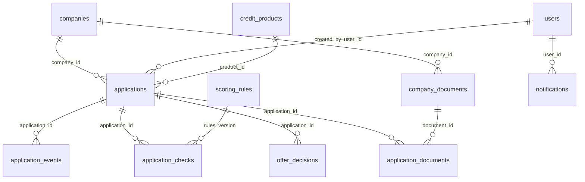

# Руководство для проверяющего

**Альфа / Поток — конкурсный MVP. Состояние на 26.10.2026.**

Кабинет объединяет подбор финансирования, заявку и решение банка. Все компании, пользователи и финансовые данные синтетические. Скоринг — правила, а не обученная ML-модель; подписание и выдача моделируются.

## 1. С чего начать

1. Запустите оба сервиса по [README](../README.md#быстрый-старт). Frontend без backend не даёт пройти кредитный сценарий.
2. Проверьте `GET /api/v1/health`, откройте Swagger `/docs` и OpenAPI `/openapi.json` на порту backend.
3. Клиента `cafe@demo.ru` и банк `bank@demo.ru` откройте в разных профилях браузера; пароль — `123456`.
4. Пройдите [основной сценарий](../README.md#сценарий-проверки-за-510-минут): 800 000 ₽ / 24 месяца / закупка товаров → заявка → решение банка → принятие → демоподписание → демовыдача.
5. Альтернатива браузеру — [API_EXAMPLES.http](API_EXAMPLES.http): 13 последовательных запросов для VSCode REST Client с автоматическим захватом токенов и номера новой заявки. Это реальные мутации выбранной demo-БД; сброса данных в коллекции нет.

Версию сдачи определяет Git commit полученного репозитория: `git rev-parse HEAD`. Не сбрасывайте существующую БД ради повторной проверки: новый проход коллекции создаёт отдельную заявку.

## 2. Контрольные сценарии и ожидаемый результат

| Сценарий | Как проверить | Ожидаемый результат |
|---|---|---|
| Положительный путь | `cafe@demo.ru`, свежий seed, 800 000 ₽ / 24 мес. / товары | Есть точные предложения; после решения банка статусы `review → offer → sign → ready → disbursed` |
| Изменённые условия | `client@demo.ru`, 800 000 ₽ / 24 мес. / товары | Доступны меньшие суммы. ⓘ показывает реальные отличия и причины; исходный запрос не изменён |
| Счётчики | Сопоставить сводку с группами карточек | Рассмотрены все варианты, включая недоступные; уменьшенная сумма на другом сроке не удваивает счётчик полной суммы на другом сроке |
| Дополнительные сведения | Банк выбирает `need_info`, клиент отвечает | `review → need_info → review`; комментарии и связь с существующими документами сохраняются |
| Отказ / отклонение | Банк отказывает или клиент отклоняет оффер | `rejected`, причина и событие остаются в истории |
| Повтор действия | Повторить принятие или подписание через API | `409 INVALID_STATUS_TRANSITION`, без повторного перехода |
| Права доступа | Клиент запрашивает чужую заявку / банковский endpoint | `404` для скрытого чужого ресурса / `403` для неподходящей роли |
| Сохранение данных | Обновить страницу после решения | Статус, условия, история и исходная оценка сохранены |
| Сбой сервера | Остановить только тестовый backend, попробовать вход/выход | Аккуратная ошибка подключения, не ошибка пароля; неуспешный logout не объявляется успешным |

На фиксированных seed-данных «Города» четыре альтернативы и два недоступных варианта дают шесть рассмотренных. Бюджет нового платежа: `(900 000 − 740 000) / 1,25 − 120 000 = 8 000 ₽/мес.`. Исходный оборотный кредит 800 000 ₽ / 24 мес. требует 42 296,88 ₽/мес. Это ограничение профиля, а не потеря предложений на frontend.

Изменения приходят по WebSocket; резервный опрос API работает раз в 15 секунд в видимой вкладке. Предварительная оценка не является окончательным одобрением банка. Stress-расчёты остаются в API и исторических снимках, но не отображаются в текущем интерфейсе.

## 3. Модель данных

Упрощённая схема основных внешних ключей; полная ORM-модель — [backend/src/models.py](../backend/src/models.py), API-семантика — [CONTRACTS.md](CONTRACTS.md).

- `applications` — запрос и текущее состояние; `application_events` — история; `offer_decisions` — условия и решения банка.
- `application_checks` хранит снимок входов, факторов, проверок и исходной оценки; текущий профиль и последующий оффер могут отличаться.
- `application_documents` связывает заявку только с документами той же компании через составные внешние ключи. Ответ на `need_info` не загружает новый файл и не меняет финансовый профиль.
- `recommendation_audits` отдельно хранит версии, входы, результат и hashes расчёта/решения. Его `actor_id` и `company_id` — snapshot-идентификаторы без внешних ключей, поэтому таблица не соединена на схеме. ORM запрещает изменение/удаление audit-записей; это не цифровая подпись.
- Пользователь клиента привязан к компании; у банковского пользователя `company_id = NULL`. Схема выше показывает основные связи, а не все поля и ограничения.

## 4. Подтверждённые проверки

Проверки повторены 26.10.2026 на установленных зависимостях. Unit/API-тесты не запускали сетевой сервер; отдельный браузерный smoke запускал временные backend/frontend с новой SQLite. Существующая локальная БД не сбрасывалась.

| Проверка | Результат |
|---|---|
| `.venv/Scripts/python.exe -m pytest tests backend/tests -q` | **113 passed, 72 subtests passed** |
| `npm test` из `frontend` | **28 passed**; это тесты утилит, не браузерный E2E |
| TypeScript + production-сборка Vite | Успешно; предупреждение о chunk >500 kB |
| Полный Oxlint | Прямая команда: 0 ошибок, 1 warning `react(refs)` в `RecommendationInfo.tsx`; `npm run lint` не стартовал из-за отсутствующего launcher |
| Браузерный smoke | Один положительный путь в Chrome headless, две независимые сессии, временная SQLite: `review → offer → sign → ready → disbursed`, reload и проверка истории через API |
| Коллекция API | 13/13 запросов дали HTTP 200 через production-роутеры и SQLite in-memory; проверены история, роли и повторные переходы |
| Markdown-ссылки / `git diff --check` | Локальные ссылки и форматирование проверены перед сдачей |

API/workflow-тесты работают с изолированными in-memory БД. Для браузерного smoke использованы временные порты 15173/18000; процессы остановлены после проверки. SHA-256 существующего `alfa-credit-hub.db` до/после совпал. Команды повторного запуска — в [README](../README.md#тесты-и-сборка).

**Не проверены:** Docker на чистом окружении, полная браузерная E2E-регрессия и негативные ветки, доступность, нагрузка, production deployment и полный security/license audit. Docker-конфигурация есть, но наличие файлов не равно подтверждённому запуску контейнеров.

## 5. Границы решения

- ФНС/БКИ — локальные моки; документы, подпись и деньги — демонстрационные. Assistant — шаблонный endpoint без внешней LLM. Компоненты, версии и лицензии перечислены в [THIRD_PARTY_NOTICES.md](../THIRD_PARTY_NOTICES.md).
- Новостная лента пока общая статическая, без персонализации. Её изменение под клиента отдельно запрошено на стр. 7 кейса и остаётся незакрытым требованием. Проведение CustDev и качество обученной модели не заявляются.
- Прямой API создания заявки допускает непроходящий assessment, хотя UI ограничивает подачу; для реального продукта нужна согласованная серверная политика.
- Для реальных данных нужны PostgreSQL/миграции, идемпотентность и конкурентная безопасность, secrets/HTTPS/Secure-cookie, rate limiting, настройка CORS/WS Origin и закрытие публичных demo endpoint’ов, особенно `/demo/reset`.
- Realtime registry однопроцессный; outbox/broker/replay нет. Score и версии политик — демонстрационные, не банковская PD-модель или автоматическое решение о выдаче.

Подробный разбор проделанной работы, отклонений от кейса и roadmap с критериями готовности — в [TEAM_REPORT.md](TEAM_REPORT.md). Полные контракты, формулы, ограничения и ошибки — в [CONTRACTS.md](CONTRACTS.md). Архитектура, состояния и быстрый запуск — в [README](../README.md).
